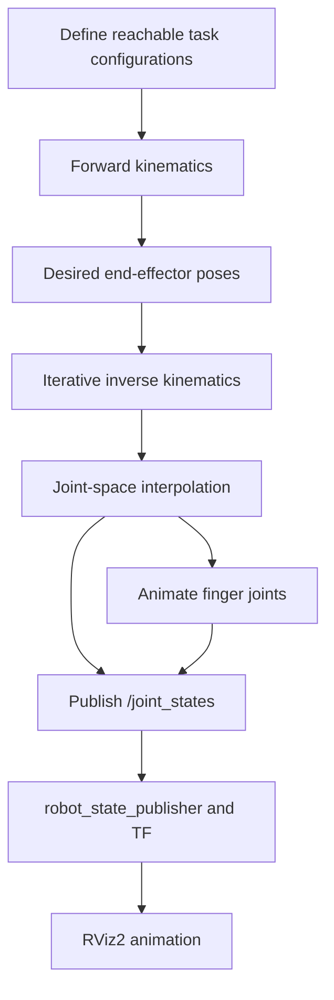

# ROS 2 Forward & Inverse Kinematics | 7-DoF Robot Arm

**A teaching-oriented ROS 2 Humble project demonstrating forward kinematics, numerical inverse kinematics, articulated robot motion, and a two-finger gripper in RViz2.**


> **Teaching objective:** Given joint angles, calculate the end-effector pose (FK). Given a desired end-effector pose, calculate suitable joint angles (IK). Then visualize the resulting motion in RViz2.

## At a glance

| Feature | What this project demonstrates |
|---|---|
| Forward kinematics (FK) | Joint configuration → 3D end-effector position and orientation |
| Inverse kinematics (IK) | Desired end-effector pose → feasible joint configuration |
| 7-DoF manipulator | Redundancy and multiple possible configurations |
| Jacobian-based numerical IK | Iterative updates toward a target |
| Motion sequencing | Named stages such as approach, grasp, lift, transfer, place, and return |
| Gripper visualization | Two finger joint positions published with the arm joints |
| ROS 2 integration | `sensor_msgs/JointState`, `robot_state_publisher`, TF and RViz2 |

## Demo preview

**Add your recorded RViz demonstration here** after uploading it to `media/robot_demo.mp4`:

`[Watch the RViz demonstration](media/robot_demo.mp4)`

*This project animates robot joint states and gripper fingers; it does not physically attach an object, simulate contact forces, or verify a collision-free grasp.*

## Understanding the two kinematics problems

### 1 — Forward kinematics

**Given:** joint angles `q = [q1, q2, ..., q7]`.

**Find:** the end-effector pose `T(q)`, containing position and orientation.

For a serial manipulator, the pose is obtained by multiplying the successive link/joint transformations:

```math
T_{0}^{EE}(q) = T_{0}^{1}(q_1)\,T_{1}^{2}(q_2)\,\cdots\,T_{7}^{EE}(q_7)
```

In the Python implementation, look for the `fk(...)` method in `kinematics.py`.

### 2 — Inverse kinematics

**Given:** desired end-effector pose `T_target`.

**Find:** joint configuration `q*` such that `T(q*) ≈ T_target`.

A common numerical approach uses a damped-least-squares Jacobian step:

```math
\Delta q = J^T (JJ^T + \lambda^2 I)^{-1} e
```

where `J` is the Jacobian, `e` is the pose error, and `λ` is the damping parameter. Iterative numerical IK can fail for unreachable targets, joint limits, or difficult initial conditions. For seven joints and a six-dimensional task, multiple IK solutions may exist.

### Why use both?

- **FK** answers: “Given these joint angles, where is the gripper?”
- **IK** answers: “To reach this gripper pose, what joint angles could work?”
- **Motion generation** answers: “How do we move smoothly between valid joint configurations?”

These are related tasks, but calculating FK/IK does **not** by itself command a physical robot.

## Conceptual workflow



**Important technical distinction:** The V4 teaching demo generates example target poses from known reachable configurations and solves IK for those poses. It is not an autonomous perception-and-manipulation pipeline.

## Project layout

```text
panda_fk_ik_demo/
├── package.xml
├── setup.py
├── setup.cfg
├── resource/
│   └── panda_fk_ik_demo
├── panda_fk_ik_demo/
│   ├── __init__.py
│   ├── kinematics.py        # FK, pose error, Jacobian, numerical IK
│   └── demo.py              # Motion stages, interpolation, ROS publishers
├── launch/
│   └── demo.launch.py       # State publisher, demo node, RViz
└── rviz/
    └── panda_fk_ik.rviz     # Visualization settings
```

See [CODE_WALKTHROUGH.md](CODE_WALKTHROUGH.md) for the algorithm-by-algorithm explanation.

## Requirements

- Ubuntu 22.04 (native or Windows 11 WSL2 with GUI support)
- ROS 2 Humble, Python 3 and `colcon`
- RViz2 and `robot_state_publisher`
- The ROS 2 Panda robot description package used by the launch file

Example dependency installation:

```bash
sudo apt update
sudo apt install -y \
  ros-humble-rviz2 \
  ros-humble-robot-state-publisher \
  ros-humble-moveit-resources-panda-description \
  python3-colcon-common-extensions
```

## Build and run

The repository should contain the `panda_fk_ik_demo` package folder before attempting these commands.

```bash
# Ubuntu terminal
source /opt/ros/humble/setup.bash
mkdir -p ~/panda_ws/src
cd ~/panda_ws/src
git clone https://github.com/sh1755/ROS2-Forward-Inverse-Kinematics-repository.git

# Build only the demo package
cd ~/panda_ws
colcon build --symlink-install --packages-select panda_fk_ik_demo
source install/setup.bash

# Launch the robot in RViz2
ros2 launch panda_fk_ik_demo demo.launch.py
```

**Note:** If the repository was cloned into `src`, ROS 2 will discover the Python package in its `panda_fk_ik_demo` subfolder. Make sure no duplicate copy of the package exists in the same workspace.

### Inspect the live data

Open a second Ubuntu terminal:

```bash
source /opt/ros/humble/setup.bash
source ~/panda_ws/install/setup.bash

ros2 topic echo /joint_states --once
ros2 topic echo /panda_fk_ik/status
ros2 run tf2_ros tf2_echo panda_link0 panda_hand
```

You should see seven arm joint names and two finger joint names in `/joint_states` when the gripper-enabled demo is running.

## How to explain the code in class

| Code operation | Student explanation |
|---|---|
| `pose = arm.fk(q)` | Compute the end-effector pose from known joint angles |
| `q_goal, success, steps, err = arm.ik(pose, q_seed)` | Find joint angles for the desired pose |
| `s = 3u² − 2u³` | Ease between the start and target joint configurations |
| Publish `/joint_states` | Send arm and finger positions to the ROS 2 visualization pipeline |

### Suggested 30-second teaching narrative

> “Forward kinematics converts the seven joint angles into a gripper pose. Inverse kinematics solves the reverse problem, estimating joint angles for a desired pose. We then interpolate between configurations and publish joint states in ROS 2. RViz and TF show the resulting arm movement. This is a kinematic visualization, not a collision-checked physical robot command.”

## Scope and limitations

- **Simulation visualization only:** No commands are sent to physical robot hardware.
- **No object dynamics:** Closing the gripper does not imply the object is grasped.
- **No MoveIt collision planning:** The animation does not prove paths are obstacle-free.
- **Not a calibrated robot controller:** Joint interpolation and numerical IK are for educational use.
- **Not complete Cartesian tracking:** Sequence stages do not guarantee straight-line Cartesian movements.

## Author and educational use

**Dr Sajjad Hussain** — Robotics, Human–Robot Interaction and ROS 2 teaching.

This repository documents a standalone ROS 2 FK/IK educational demonstration. Earlier physical-robot C++/libfranka research code is intentionally **not included**.

## Next improvements

1. Record and add an RViz video in `media/`.
2. Add target markers for the desired end-effector pose.
3. Add an interactive Cartesian target input.
4. Compare damped least squares with another numerical IK solver.
5. Incorporate MoveIt 2 collision checking before considering any real hardware use.
